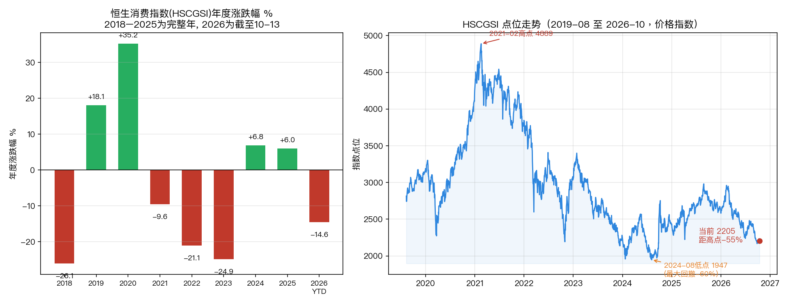
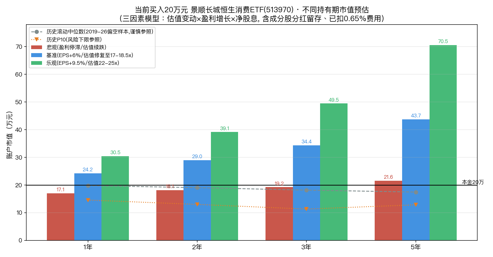

# 景顺长城恒生消费 ETF（513970）：历史十年表现复盘 + 现价买入 20 万元的多逻辑收益测算

> **版本 v1.0 · 数据截止日（data cutoff）：2026-10-13（盘中约 13:00，港币指数）**
> 研究对象：景顺长城恒生消费 ETF（QDII），场内代码 **513970**，跟踪 **恒生消费指数 HSCGSI**
> 配套图表：[历史表现图](hscgsi_etf_perf.png) ｜ [20 万情景测算图](hscgsi_etf_200k.png)
> **声明：本文为基于公开信息的研究分析，不构成投资建议。**

---

## TL;DR（不读正文也能决策）

1. **基金本身只有 3.5 年历史**（2023-04-12 成立），"近十年"必须看它跟踪的指数 HSCGSI（指数 2015-08-17 才发布，2010 年为回溯基日）。精确年度数据自 **2018 年**起、精确日线自 **2019-08** 起；**2016、2017 两个年度的精确涨跌在免费公开渠道不可得**（需 Wind/Choice），本文不编造，只用官方长期指标刻画。

2. **这是一只"长期回报平庸、波动巨大、当前极端低估"的指数。** 2021-02 见顶 4889 点后最大回撤 **−60%**，当前约 2205 点、距高点仍 **−55%**；近 5 年价格年化 **−10.4%**（含分红总回报年化 **−7.6%**）。但拉长到 2010 年基日，**含分红 16.6 年年化仅约 +0.9%**——这是它最需要被正视的底色。

3. **当前赔率高、胜率待验证**：PE 约 11.4–13.2 倍（近十年 <1% 分位，L1/L4），股息率官网口径 **4.78%**，年化波动率约 **27%**。便宜是事实，但"便宜可以更便宜"已在 2024→2026 上演过一次。

4. **20 万元、按三套逻辑测算（详见第六节），核心结论是"区间极宽、没有可信单点"：**
   - **基准情景（盈利年增 6% + 估值修复到 17–18.5 倍）**：1 年 ≈ **24.2 万**、3 年 ≈ **34.4 万（+72%）**、5 年 ≈ **43.7 万（+119%）**；
   - **悲观情景（盈利停滞、估值再下台阶）**：1 年可能 **17 万（−15%）**，但靠 4%+ 股息，持有 5 年仍有望回到 **21.6 万（微赚）**；
   - **历史滚动分布（风险参照，非预测）**：持有 3 年的极端尾部可能只剩 **约 10 万元（−50%）**，P25 也只有 13.4 万。
   - **底线逻辑（假设估值永远不修复，只赚盈利+股息）**：现实年化约 **+1.5%（零增长）到 +8%（盈利增 6%）**，即 5 年 21.6 万 ~ 29.6 万。

5. **定位建议**：高波动卫星仓 / 左侧分批或定投，不建议一次性 20 万 all-in；安全边际来自"即使估值不修复、靠股息+个位数盈利增长也大体不亏"，向上弹性来自估值均值回归。**买入前请确认自己能承受 −40% 的中途浮亏。**

---

## 一、决策问题与什么证据会改变结论

**要支撑的决策**：现在（2026-10-13，指数约 2205、ETF 约 0.766 元）一次性买入 20 万元 513970，持有 1/2/3/5 年后，分别可能值多少？这些数字分别是按什么逻辑算出来的？

**会改变结论的关键证据（kill criteria）**：
- 成分股 EPS 连续两年负增长 → 基准情景的 g=6% 被证伪，应下修至悲观；
- PE 在盈利不下修的情况下持续低于 11 倍超过 4 个季度、且跌破 2024-08 低点 1947 → "价值陷阱 / 港股流动性永久折价"坐实；
- 社零增速、家电服装出口、餐饮动销回升至 3%+ 且南向资金持续净流入 → 胜率上行，可从悲观向基准上调；
- 股息率被动抬高仅来自一次性特别股息（如万洲、创科的特殊派息）→ 4.78% 不可持续，d 假设需下调。

---

## 二、标的基本信息

| 项目 | 内容 | 证据等级/来源 |
|---|---|---|
| 基金全称 | 景顺长城恒生消费交易型开放式指数证券投资基金（QDII） | L1 上市公告书 |
| 场内代码/简称 | **513970** / 恒生消费 ETF 景顺 | L1 |
| 基金合同生效日 | **2023-04-12**；上交所上市 2023-04-21 | L1 上市交易公告书 |
| 跟踪指数 | **恒生消费指数 Hang Seng Consumption Index（HSCGSI）** | L1 招募说明书 |
| 指数发布日/基日 | 2015-08-17 发布；**基日 2010-03-05，基值 3,000**；2015 年前为回测 | L1 官网 factsheet |
| 成分/加权 | 固定 50 只，流通市值加权，单只上限 10%，港币计价 | L1 |
| 管理费 + 托管费 | **0.50% + 0.15% = 0.65%/年**（另含审计、指数授权、交易等运作费） | L1 产品资料概要（2026-06-30） |
| 分红 | **上市以来从未分红**（前复权与不复权价格无差异）；成分股分红留存于基金净值 | L3 东财行情复权对比 |
| 最新场内价 | 约 **0.766 元**（2026-10-13）；2026-06-30 净值 0.7809；规模约 11.9 亿元 | L3/L2 |

> 同名系列产品还有：嘉实 520620、广发 159699（深交所）、华泰柏瑞 520520，以及中欧/嘉实/永赢的场外指数基金（官网 products 接口）。513970 是其中规模最大、成立最早的一只。

### 前十大成分股（L1 官网 factsheet，2026-09-30）

创科实业 10.36%、泡泡玛特 8.97%、百胜中国 8.94%、安踏 8.28%、农夫山泉 6.44%、美的集团 4.56%、蒙牛 4.44%、万洲国际 4.43%、海尔智家 3.94%、华润啤酒 2.44%。**前十大合计约 63%，不含白酒**（港股无白酒标的），以家电、运动服饰、餐饮、食品饮料等可选消费为主。

---

## 三、近十年表现复盘

> **数据边界（务必先读）**：指数日线/年线的免费可靠序列自 **2019-08** 起（东财，1766 个交易日，已用恒生官网数据交叉验证）；2018–2022 年度涨跌由**景顺长城基金官方发行材料**给出（L2），且 2019 年起与东财日线完全吻合（误差 <0.01%）。**2016、2017 年度精确值未取得，标注为数据缺口，不做估算填充。**

### 3.1 年度涨跌幅（价格指数，不含分红）

| 年度 | 涨跌幅 | 收盘点位 | 依据 |
|---|---:|---:|---|
| 2016 | **数据缺口（免费源不可得）** | — | 指数 2015-08 才发布，Wind/Choice 才有 |
| 2017 | **数据缺口**；可反推 2017 年末点位≈**3,604** | ≈3,604 | 由官方 2018/2019 年度涨跌反推，非直接观测 |
| 2018 | **−26.06%** | ≈2,664 | L2 基金公司官方 |
| 2019 | **+18.07%** | 3,146 | L2 官方 + L3 日线一致 |
| 2020 | **+35.20%** | 4,254 | 同上 |
| 2021 | **−9.57%** | 3,846 | 同上 |
| 2022 | **−21.08%** | 3,036 | 同上 |
| 2023 | **−24.89%** | 2,280 | L3 东财日线 |
| 2024 | **+6.84%** | 2,436 | L3 东财日线 |
| 2025 | **+5.97%** | 2,581 | L3 东财年线 |
| 2026（至 10-13） | **−14.58%** | 2,205 | L3 东财；官网 YTD（至 9-30）−14.57%，互相印证 |

> 直观特征：**2020 年 +35% 的高光之后是 2021–2023 年"三年里头两年跌超 20%"的长熊**，2024–2025 弱反弹，2026 年再度回落并逼近 2024 年低点。典型的"消费升级泡沫 → 均值回归 → 流动性折价"。

### 3.2 区间收益、回撤与波动（L3 日线计算 + L1 官网校准）

| 指标 | 数值 | 口径/来源 |
|---|---:|---|
| 2019-08 → 2026-10（7.17 年）价格 | 累计 **−21.7%**，年化 **−3.35%** | 本文按日线计算 |
| 近 5 年价格回报 | 累计 −42.1%，**年化 −10.4%** | 日线；官网 factsheet 5 年年化 **−10.52%** |
| 近 5 年**含分红总回报（TRI）** | 累计 −32.6%，**年化 −7.6%** | 恒生官网 HSCGSI TRI |
| 近 3 年价格 | 累计 −11.0%，年化 −3.81%（官网 3 年年化 −4.37%） | 日线/L1 |
| 近 1 年价格 | **−19.3%**（官网 1 年 −21.50%，截至 9-30） | 日线/L1 |
| **历史最大回撤** | **−60.2%**：2021-02-17 的 4,889 → 2024-08-05 的 1,947 | 日线 |
| 当前距历史最高收盘 | **−54.9%** | 日线 |
| 年化波动率 | **26.9%**（官网：1 年 18.1% / 3 年 24.4% / 5 年 27.0%） | 日线/L1 |
| 近 5 年分红再投资贡献 | 约 **+2.77%/年**（TRI−PI 差，未扣费） | 官网 TRI vs PI |
| 2010 基日以来（16.6 年） | 价格年化 **−1.8%**；**含分红 TRI 年化约 +0.9%** | 官网当前点位/3,000 推算（TRI 同基值假设，见风险注释） |

> **最重要的一个数字**：即便把成分股每年约 3–4.8% 的分红全部再投资，过去 16.6 年这只"消费"指数的年化总回报也只有 **约 +0.9%**（且 2010 起点估值不算极端泡沫）。这说明**港股消费板块长期受估值中枢下移拖累，"买入好行业躺赢"在这只指数上不成立**——收益高度依赖"买入时的估值位置"。这恰是当前 <1% 分位估值值得重视、但又不能简单线性外推的原因。

### 3.3 ETF（513970）上市以来实际回报

| 区间 | ETF（前复权价） | 同期价格指数 | 差异 |
|---|---:|---:|---:|
| 2023-04-21（0.972 元）→ 2026-10-13（0.766 元），3.48 年 | 累计 **−21.2%**，年化 **−6.62%** | 累计 −25.1%，年化 ≈−8.0% | **+约 1.3%/年** |

- 这 +1.3%/年的超额，来自**成分股分红留存于净值**（约 2.8%/年）**减去 0.65% 基金费用与跟踪误差/折溢价**。
- ETF 年度（二级市场收盘价）：2024 年 **+10.7%**、2025 年 **+5.3%**、2026 YTD **−16.1%**（含折溢价噪声，长期贴近净值）。
- 这也给后面的测算标定了一个关键参数：**投资者真实的"净分红增厚"取约 2.0%/年**（比指数层面 2.77% 保守，已扣费用与摩擦）。

---

## 四、当前估值与基本面（测算的输入参数）

| 参数 | 取值 | 来源/日期 |
|---|---:|---|
| 指数点位（2026-10-13 盘中） | ≈2,205–2,210 | L3 新浪/东财实时 |
| PE(TTM) | **13.21 倍**（9-30）；10-12 国信证券口径 **11.4 倍**；模型起点取 **12.5 倍**并做 11/12.5/14 敏感性 | L1 官网 / L4 国信 |
| 历史 PE 分位 | **近十年 <1%**（2026-06 起多家券商一致口径） | L4 |
| 股息率 | **4.78%**（官网 9-30） | L1 |
| 年化波动率 | 约 27% | L1 |
| EPS 增速预期 | 2026E +11.1%、2027E +10.1%（一致预期，L4，未经独立核验）；模型长期 g 取 0%/6%/9.5% 三档 | L4 |
| 基金综合费用 | 0.65%/年（管理+托管）+ 少量运作费 | L1 |
| 净分红增厚 d（投资者口径） | 悲观 1.5% / 基准 2.0% / 乐观 2.3% | 本文用 TRI−PI 与 ETF 实测校准 |

---

## 五、测算方法说明：为什么要用三套逻辑

任何"未来能赚多少"的单点预测都是伪精确。本文刻意用**三套相互独立、可证伪的逻辑**交叉给出区间，回答三个不同问题：

- **逻辑一（历史分布法 · 归纳）**：过去真正买入并持有 1/2/3/5 年，实际发生的回报长什么样？→ 回答"风险/尾部有多大"。
- **逻辑二（三因素情景法 · 演绎）**：未来回报 = 估值变化 × 盈利增长 × 分红，从当前 12.5 倍 PE 出发，悲观/基准/乐观各值多少？→ 回答"以今天的价格，赔率是多少"。
- **逻辑三（底线法）**：假设估值**永远不修复**，光靠盈利和分红能赚多少？→ 回答"最差的合理情况下，安全边际有多厚"。

> 本金统一为 **20 万元**，时间点指**持有满 1/2/3/5 年**；口径为 ETF 投资者总回报（含成分股分红留存净值、已扣 0.65% 费用）。**人民币/港币汇率波动单列（见第八节），未计入下列数字。**

---

## 六、20 万元多时间点收益测算（核心）

### 逻辑一：历史滚动持有分布（2019-08 至 2026-10 全部交易日滚动；已加约 +2.0%/年净分红换算为总回报口径）

| 持有 | 最差 | **P10** | P25 | **中位数** | P75 | P90 | 最好 |
|---|---:|---:|---:|---:|---:|---:|---:|
| **1 年**回报 | −44.3% | −27.1% | −18.5% | −1.0% | +18.4% | +41.2% | +86.7% |
| 1 年终值 | **11.1 万** | 14.6 万 | 16.3 万 | 19.8 万 | 23.7 万 | 28.3 万 | 37.3 万 |
| **2 年**回报 | −45.1% | −35.0% | −26.9% | −4.7% | +14.6% | +28.1% | +55.1% |
| 2 年终值 | **11.0 万** | 13.0 万 | 14.6 万 | 19.1 万 | 22.9 万 | 25.6 万 | 31.0 万 |
| **3 年**回报 | −50.3% | −43.4% | −33.1% | −9.2% | −1.3% | +7.4% | +39.1% |
| 3 年终值 | **9.9 万** | 11.3 万 | 13.4 万 | 18.2 万 | 19.7 万 | 21.5 万 | 27.8 万 |
| **5 年**回报 | −38.8% | −35.6% | −31.0% | −12.6% | −4.6% | +4.1% | +24.8% |
| 5 年终值 | **12.2 万** | 12.9 万 | 13.8 万 | 17.5 万 | 19.1 万 | 20.8 万 | 25.0 万 |

**怎么用这张表（重要，避免误读）**：
- 样本期只有 7.17 年、且**恰好是一轮从高估值（2021 顶）到深度低估（2026）的单边下行周期**，3 年滚动正收益占比仅约 11%。**这是有偏样本，中位数为负不代表未来 3 年大概率亏钱。**
- 绝大多数滚动起点的估值**高于当前**（当前 <1% 分位），因此用"全样本中位数"来预期"今天买入"是双重悲观。
- **它真正告诉你的是尾部风险**：在这只指数上，即便做好持有 3–5 年的准备，极端情况下本金仍可能腰斩到 **约 10 万元**。买入前必须能接受这一幕。

### 逻辑二：估值 × 盈利 × 股息 三因素情景（从当前 PE=12.5 出发）

**公式：终值 = 20 万 × (期末PE / 12.5) × (1 + g)^T × (1 + d)^T**

| 情景 | 假设（g=EPS年增, d=净股息, 期末PE） | 1 年 | 2 年 | 3 年 | 5 年 |
|---|---|---:|---:|---:|---:|
| **悲观** | g=0%，d=1.5%，PE 10.5→11→11.5→12.5 | **17.1 万** | 18.1 万 | 19.2 万 | **21.6 万** |
|  | 区间累计/年化 | −14.7% | −9.3%（−4.8%/年） | −3.8%（−1.3%/年） | **+7.7%（+1.5%/年）** |
| **基准** | g=6%，d=2.0%，PE 14→15.5→17→18.5 | **24.2 万** | 29.0 万 | **34.4 万** | **43.7 万** |
|  | 区间累计/年化 | +21.1% | +45.0%（+20.4%/年） | **+71.9%（+19.8%/年）** | **+118.7%（+16.9%/年）** |
| **乐观** | g=9.5%，d=2.3%，PE 17→19.5→22→25 | **30.5 万** | 39.2 万 | **49.5 万** | **70.6 万** |
|  | 区间累计/年化 | +52.3% | +95.8%（+39.9%/年） | +147.4%（+35.2%/年） | +252.8%（+28.7%/年） |

**主观概率加权期望（概率为作者主观假设，非市场共识）：**

| 持有期 | P(悲观/基准/乐观) | 期望终值 | 期望盈亏 | 期望年化 |
|---|---|---:|---:|---:|
| 1 年 | 32% / 45% / 23% | **23.4 万** | +3.4 万 | +16.8% |
| 2 年 | 30% / 46% / 24% | **28.2 万** | +8.2 万 | +18.7% |
| 3 年 | 22% / 50% / 28% | **35.3 万** | +15.3 万 | +20.8% |
| 5 年 | 20% / 50% / 30% | **47.3 万** | +27.3 万 | +18.8% |

**敏感性（决定结论的两个旋钮，以基准 3 年为例）：**
- **起点 PE**：若实际 PE 是 11 倍（更低估）→ 3 年 **39.1 万（+25%/年）**；若是 14 倍 → 30.7 万（+15.3%/年）。**买入估值每差 1 倍 PE，3 年收益差约 5–8 个百分点/年。**
- **EPS 增速 g**（估值 12.5→17 固定）：g=0% → 28.9 万；g=3% → 31.5 万；g=6% → 34.4 万；g=10% → 38.4 万。

> **必须诚实说明**：基准/乐观的高年化（17%–35%）**绝大部分来自"估值从历史极低位修复一次"**，修复完成后不可持续，不能当作长期复利。把它理解为"**深低估品种的赔率**"而非"**每年都能赚 20%**"。概率是主观的，真实分布可能更接近悲观与基准之间。

### 逻辑三：底线思维——如果估值永远不修复

完全不指望 PE 回升，回报只来自盈利增长 + 净分红（年化 ≈ g + d）：

| 假设 | 年化 | 1 年 | 3 年 | 5 年 |
|---|---:|---:|---:|---:|
| 盈利零增长，纯吃净息 | **+1.5%** | 20.3 万 | 20.9 万 | **21.6 万** |
| 基准：g=6% + d=2% | **+8.1%** | 21.6 万 | 25.3 万 | **29.6 万** |
| 乐观：g=9.5% + d=2.3% | **+12.0%** | 22.4 万 | 28.1 万 | **35.3 万** |

**历史上"深度低估之后"的参照（价格指数，未含约 2.8%/年股息）：**
- 2018 年底 PE 约 15 倍（贸易战底）→ **2019 +18.1%、2020 +35.2%，两年累计约 +60%**；
- 但 **2024-08 低点 1947 → 2025 年末 2581（+33%）后，2026 年又跌回 2205**——这正是"低估可更低估 / 价值陷阱"的活体反例，说明时间点无法预测，只能用仓位和分批管理。

---

## 七、三套逻辑的对照与综合判断

| 问题 | 答案 |
|---|---|
| 最可能精确命中哪个数？ | **都不会**。真实结果大概率落在"悲观"与"基准"之间，短期（1 年）几乎不可测（历史 1 年区间 −44%~+87%）。 |
| 向上空间（赔率） | 3 年 +70% 量级（基准）、翻倍以上（乐观，需消费复苏 + 估值双击）。 |
| 向下风险 | 1 年 −15% 很常见；极端尾部 3 年 −40%~−50%（历史真实发生过）。 |
| 安全边际 | 4.8% 股息率 + 个位数盈利增长，意味着"**估值不修复也能争取年化 1.5%–8%、5 年大体不亏到小赚**"。 |
| 时间的作用 | 时间拉长，**股息+盈利的确定性累积上升、纯估值波动的占比下降**；但"价值陷阱"下时间也未必是朋友（2021 顶买入持有 5 年至今仍 −42%）。 |

**操作含义（仅为研究视角，非投资建议）**：
- 当前位置更适合**左侧分批/定投**而非一次性 20 万满仓；若一定要一次性买入，应明确这是高弹性卫星仓且能承受 −40% 浮亏；
- 20 万可考虑拆成 3–5 批，在 PE ≤12 倍、指数靠近/跌破 1,950–2,050 区域逐步加码，把"买点估值"这个最确定的旋钮掌握在自己手里；
- 持有期至少按 **3 年以上**规划，靠股息+盈利打底、等待估值回归。

---

## 八、风险与未计入因素（kill criteria 与监控信号）

1. **价值陷阱/估值永久折价**：港股流动性弱、外资流出，低估值可长期维持。监控：PE 持续 <11 倍且跌破 1,947 后基本面继续恶化 → 止损重估。
2. **可选消费周期性 + 无白酒压舱**：家电/服装/餐饮受地产、出口、居民收入影响大，波动高于 A 股必选消费。
3. **盈利下修**：g=6% 是基准命门。监控：社零增速（2026 年 1–8 月仅 +1.1%）、家电服装出口、龙头批价/动销/同店。
4. **高股息率的"含金量"**：4.78% 含股价大跌的被动抬升，若含一次性特别派息则不可持续，需核对成分派息结构。
5. **汇率风险（未计入上述测算）**：QDII 持有港币资产，港币联系汇率盯美元（7.75–7.85 区间）。人民币若对美元升值，人民币份额收益被侵蚀；贬值则增厚。近年人民币/港币年波动通常在 ±2%~5%。
6. **集中度与个股黑天鹅**：前十大占 63%，单只上限 10%，创科/泡泡玛特/百胜任一事件冲击大。
7. **QDII 特有**：额度、申赎溢价、交易时间错位导致的场内折溢价；二级市场价格短期可能偏离净值。
8. **数据口径风险**：TRI 长期 +0.9% 年化为"TRI 与 PI 同以 2010 年 3,000 为基值"假设下的推算；2016/2017 年度数据缺失。精确长期归因建议以 Wind/Bloomberg 终端复核。

---

## 九、证据分级与数据来源

- **L1（监管/官方）**：恒生指数公司官网 HSCGSI Factsheet（2026-09-30，PE 13.21、股息率 4.78%、波动率、5 年年化 −10.52%、成分权重）；官网 HSCGSI PI/TRI 历史序列接口（indexCode 02018.00 / 12018.00）；景顺长城 513970《上市交易公告书》《基金产品资料概要（2026-06-30）》《2025 年年度报告》；上交所披露文件。
- **L2（公司披露）**：景顺长城基金官网发行材料《更纯正的消费投资利器》（2018–2022 年度涨跌：−26.06%/+18.07%/+35.20%/−9.57%/−21.08%）。
- **L3（第三方行情）**：东方财富 513970 前复权/不复权日线（2023-04 起）、124.HSCGSI 日线/年线（2019-08 起）；新浪财经 hkHSCGSI 实时点位。
- **L4（媒体/研报，线索级）**：国信证券（2026-10-12 PE 11.4x）、方正/广发证券指数分析、36 氪/上海证券报/证券日报（估值分位、EPS 一致预期）；EPS +10% 预期为未经独立核验的卖方一致预期。
- **数据缺口（显式标注）**：2016、2017 年度精确涨跌免费公开源不可得；指数 2015-08 前为回测；TRI 长期年化依赖同基值假设。

### 计算可复现性
- 原始数据与中间文件：`data_etf/`（东财/官网 JSON、factsheet PDF 与文本）；
- 统计脚本：历史指标 `/tmp/hscgsi_analyze.py`、收益模型 `/tmp/hscgsi_model.py`、出图 `/tmp/hscgsi_charts.py`；
- 所有年化均为几何年化（CAGR）；历史滚动为全部交易日重叠滚动，分位数为经验分位。

---

## 十、变更日志

| 日期 | 版本 | 内容 |
|---|---|---|
| 2026-10-13 | v1.0 | 首次成稿：HSCGSI/513970 历史复盘 + 20 万元三逻辑（历史分布/三因素/底线）多时间点测算 |

---

> **再次声明**：本文仅为公开信息研究与模型推演，**不构成任何投资建议或买卖要约**。模型中的情景、概率、g/d/期末 PE 均为可讨论的假设，历史表现不代表未来，指数与基金净值可能大幅下跌。请结合自身风险承受能力独立决策，必要时咨询持牌投资顾问。
