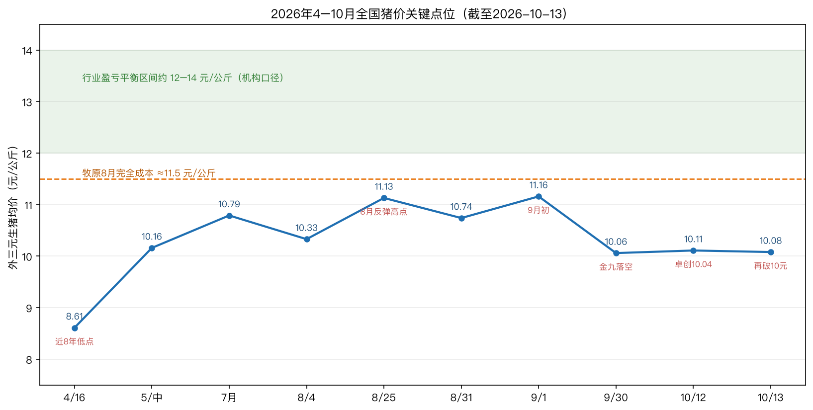
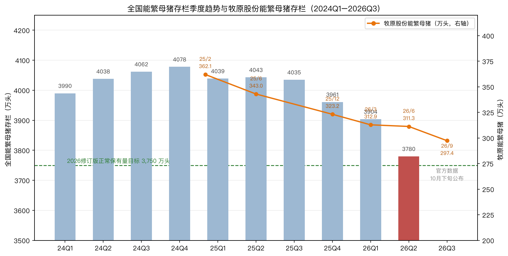

# 中国猪肉行业调研报告 v2.0：猪价"金九"落空后的磨底再确认——产能去化、龙头经营与周期拐点跟踪

> **版本**：v2.0（增量版，保留 v1.0《猪肉行业调研报告：能繁母猪与龙头企业全景》2026-08-31 不变）
> **数据截止日（data cutoff）**：2026-10-13（盘中行情标注具体时点；Q3 官方季度数据尚未发布，预计 10 月下旬公布）
> **数据口径**：国家统计局/农业农村部官方数据、上市公司法定披露公告（L1/L2）+ 第三方机构监测（Mysteel 钢联、卓创资讯、涌益咨询，L3）+ 财经媒体报道（L4），证据分级见第四节
> **重要声明**：本报告不构成任何投资建议。所有估算、外推与主观概率均已显式标注。

---

## TL;DR（可独立决策的 5 条结论）

1. **8 月版报告对 Q4"季节性反弹、高点 12–12.5 元/公斤"的判断，节奏已被证伪、时间窗口后移**：9 月"金九"旺季落空，全国外三元均价从月初 11.16 元/公斤跌至 9 月 30 日 10.06 元/公斤（月内约 -10%），10 月 12–13 日再跌至 10.04–10.11 元/公斤；机构对 12.0–12.5 元/公斤高点的预期普遍推迟到 **11 月下旬腌腊启动之后**，且全年行业大概率无法扭亏。[cite:10][cite:11][cite:16]
2. **产能去化出现"8 月加速、9 月骤降"的反复**：全国官方口径仍停留在 Q2 末 3,780 万头（距 3,750 万目标差 0.8%）；Mysteel 样本能繁母猪环比从 8 月 -2.94% 收窄至 9 月 **-0.86%**，规模场样本仅 -0.28%——这是当前最大的空头证据，官方 Q3 数据（10 月下旬公布）是下一个决定性验证点。[cite:14][cite:15][cite:4]
3. **牧原完成自我设定的产能目标**：9 月末能繁母猪 **297.4 万头**，兑现"9 月底降至 300 万头以下"承诺，较 2025 年初峰值 362.1 万头累计压减 17.9%；但 Q3 仍卖一头亏约 140 元（媒体按公告反推，L4），Q3 商品猪 2,011.5 万头、收入 266.7 亿元，**亏损但环比 Q2 明显收窄**；三季报 10 月 30 日披露。[cite:1][cite:2][cite:21]
4. **期货市场已抢先下修 2027 年反转预期**：新主力 LH2701 从 8 月末 12,500 元/吨上方跌至 10 月 13 日盘中约 10,695 元/吨（-约 14%）；近远月价差从 8 月的近 3,000 元收窄至约 300 元（LH2611 ~10,400 vs LH2701 ~10,700），但 LH2707 仍报 12,825 元，市场把反转从"2027 年初"后移至"2027 年中"定价。[cite:18][cite:19]
5. **基准判断（主观概率 50%）**：Q4"前弱后强、重心温和抬升"，10 月–11 月上旬外三元中枢约 9.8–10.8 元/公斤，11 月下旬腌腊旺季高点 11.5–12.5 元/公斤，**全年行业无法整体盈利，趋势性反转维持 2027 年判断不变，但反转斜率较 8 月预期更平缓**。核心风险是规模场"减量不减产"+ 9 月去化停滞使反转再推迟半年。

---

## 一、决策问题

本报告支撑的决策：

1. **是否/何时配置生猪养殖板块**（龙头股与期货远月），以及应以怎样的节奏和仓位应对"磨底延长"情景。
2. **持仓跟踪**：已按 v1.0"2027 年反转"逻辑持仓的投资者，需确认该逻辑的证据是否仍然成立，还是被 9–10 月数据破坏。
3. **产业决策参照**：补栏/出栏节奏、二育介入时点（本报告仅提供事实与情景，不提供产业经营指令）。

**什么证据会改变结论（kill criteria 预览）**：

- Q3 官方能繁母猪存栏若重新回升或仍高于 3,780 万头 → 去化停滞，反转判断推迟至 2027 H2；
- 11 月下旬腌腊旺季猪价若无法站稳 11.5 元/公斤 → Q4 扭亏无望，高负债企业信用风险上升；
- LH2701 持续跌破 10,500 元/吨且 LH2707 跌破 12,000 元/吨 → 市场对 2027 年供给收缩逻辑本身产生怀疑；
- 反之，Q3 官方存栏低于 3,750 万头且冬季腌腊拉动现货站上 12 元/公斤 → 反转确认，应转向乐观情景。

---

## 二、关键假设

| 编号 | 假设 | 依据 | 若假设错误的影响 |
|---|---|---|---|
| A1 | 能繁母猪去化传导商品猪出栏约需 10 个月 | 生物学周期，v1.0 与农业农村部专家、朱增勇等一致采用 [cite:9][cite:10] | 传导时滞改变则供给收缩时点整体平移 |
| A2 | 全国平均 PSY 已升至 23–24 头（2025 年），头部 29–32 头，"减量不减产" | 经济日报引行业分析、华夏时报/21 世纪报道 [cite:9][cite:10][cite:21] | 若 PSY 因疫病/淘汰低效母猪回落，数量去化将更快转化为供给收缩（偏多） |
| A3 | 3,750 万头为当前有效政策锚，9 月底压减大限具有刚性 | 2026 修订方案、6 月座谈会"四个带头"、9/29 国新办表态 [cite:10][cite:4] | 若执行松动，产能去化进一步停滞（偏空） |
| A4 | 需求端长期温和下行（猪肉占肉类消费 62%→58%），Q4 腌腊季节性仍有效 | 朱增勇、Mysteel/卓创季节性统计 [cite:9][cite:11] | 若消费超预期疲软，旺季高点假设下修 |
| A5 | 无全国性重大动物疫情 | 农业农村部疫情发布：国内近期仅重庆一起 O 型口蹄疫（9/8），未发布家猪非瘟疫情 [cite:28] | 北方散点非瘟若被官方证实，短期抛压后中期供给收缩（先空后多） |
| A6 | 饲料成本平稳：玉米约 2.48 元/公斤、豆粕约 3.18 元/公斤 | 全国均价周度监测转引（L3，时点为近期周度） [cite:27] | 豆粕大涨将抬高行业成本曲线、加速出清（远期偏多，近期偏空利润） |

---

## 三、证据清单（分级）

> 等级：L1 法定披露/监管数据；L2 公司主动披露/官方表态；L3 独立第三方监测；L4 媒体报道/二手转述（作线索，已尽量溯源）；L5 传闻（不作结论依据）。
> 状态："已查证"= 可溯源至原始公告/官方发布；"一方称"= 单一机构或媒体口径。

| E# | 证据（数据 + 时点） | 来源与日期 | 等级 | 状态 |
|---|---|---|---|---|
| 1 | 牧原 9 月：商品猪 642.3 万头（同比 +15.24%），均价 10.36 元/公斤（-19.57%），收入 85.20 亿元（-6.01%）；屠宰 301.5 万头；**9 月末能繁母猪 297.4 万头**；1–9 月累计商品猪 5,873 万头、收入 768.17 亿元 | 牧原 9 月销售简报，中国证券报/巨潮/HKEX，2026-10-11 [cite:1][cite:2] | L1 | 已查证 |
| 2 | 牧原 8 月：703.0 万头（+0.42%），10.30 元/公斤（-23.76%），92.54 亿元（-21.90%）；7 月：666.1 万头，10.64 元/公斤，88.97 亿元 | 牧原 7/8 月销售简报，上证报/深交所，2026-09 [cite:2][cite:3] | L1 | 已查证 |
| 3 | 牧原 2026 H1：营收 594.10 亿元（-22.3%），归母净利 **-60.78 亿元**（Q1 -12.15 亿、Q2 -48.63 亿）；商品猪 3,861.5 万头；屠宰 1,723.4 万头（+51%），屠宰肉食收入 220.61 亿元（+14.04%），两季度均盈利；H1 经营现金流净额 -22.24 亿元，Q2 末货币资金 165.47 亿元 | 牧原 2026 半年报，中国证券网/华夏时报，2026-08 [cite:20][cite:10] | L1 | 已查证 |
| 4 | 温氏 9 月：肉猪 298.83 万头（同比 -10.13%），收入 40.56 亿元（-18.47%），毛猪均价 10.75 元/公斤（-18.44%）；8 月：297.35 万头，40.16 亿元（-16.77%） | 温氏 9 月主产品销售简报，上证报/巨潮，2026-10-08 [cite:5] | L1 | 已查证 |
| 5 | 温氏 H1：营收 467.65 亿元（-6.24%），归母净利 **-43.66 亿元**（Q2 -32.96 亿）；新希望 H1 亏损 17.02 亿元；22 家上市猪企 21 家亏损，三家头部合计亏 121.46 亿元 | 温氏中报（开源证券点评 PDF）/华夏时报汇总，2026-08/09 [cite:22][cite:10] | L1/L4 | 公司数已查证；汇总为媒体口径 |
| 6 | 天康生物 9 月：36.12 万头（同比 -0.03%、环比 -12.14%），收入 4.07 亿元（-19.88%），均价 9.79 元/公斤；罗牛山 9 月：8.23 万头（+31%），收入 0.92 亿元（-22.28%） | 公司 9 月销售简报/证券日报·e公司，2026-10-09/12 [cite:6][cite:7] | L1 | 已查证 |
| 7 | 全国能繁母猪：Q2 末 3,780 万头（同比 -6.5%，较 2025 年末 -181 万头），为 3,750 万目标的 100.8%；Q3 官方数据预计 10 月下旬发布，**本报告截止日尚未公布** | 国家统计局，国新办 7/24 发布会；经济日报 2026-09-07 [cite:9][cite:4] | L1 | 已查证 |
| 8 | Mysteel 样本能繁母猪环比：7 月 -0.62%、8 月 **-2.94%**（年内最大）、9 月 **-0.86%**；9 月商品猪存栏 +0.17%；208 家样本中 123 家规模场 9 月能繁 504.21 万头，环比 -0.28%、同比 **+1.09%** | Mysteel 钢联，同花顺 2026-10-10/券商周报 [cite:14][cite:15] | L3 | 一方称（样本口径） |
| 9 | 卓创 196 家样本：8 月末能繁 850.83 万头，环比 -1.61%、同比 -7.11%；涌益样本 8 月 -1.67%；9 月规模样本企业计划出栏环比 +2.96% | 卓创资讯/涌益咨询，2026-09 [cite:13][cite:10] | L3 | 一方称（样本口径） |
| 10 | 猪价：9/30 全国外三元 10.06 元/公斤（环比 -6.33%、同比 -17.81%），月初 11.16，月内回落近 10%，新疆最低 9.25；10/12 外三元均价 10.11、卓创均价 10.04；10/13 约 10.07–10.10 | 中国养猪网（华夏时报转）/猪易通/金融界，2026-09-30、10-13 [cite:11][cite:16][cite:17] | L3/L4 | 多源方向一致，数值差 0.1 元内 |
| 11 | 农业农村部 500 县口径：8 月第 4 周活猪 11.55 元/公斤（环比 +0.3%、同比 -18.8%），连涨 3 周；9/29 国新办称猪价"已稳定在每公斤 11 元以上" | 农业农村部监测/经济日报、中国网，2026-09-07、09-30 [cite:9][cite:4] | L2 | 官方口径，与外三元存在稳定口径差（见 5.1） |
| 12 | 猪粮比：9/9 为 4.54（出场价 11.18、玉米 2.46），9/29 为 4.38，10/12 约 4.3，持续处于过度下跌一级预警区间（<5:1） | 发改委价格监测中心/同花顺/猪易通，2026-09–10 [cite:24][cite:25][cite:16] | L1/L4 | 方向已查证，点位为多源转引 |
| 13 | 养殖亏损：8 月上旬自繁自养头均亏 196–234 元（朱增勇），行业自 2025 年 10 月连亏约 11 个月；10/12 猪易通口径自繁自养 -196.6 元、外购仔猪 -174.61 元，称连亏 14 个月 | 经济日报 2026-09-07/猪易通 2026-10-13 [cite:9][cite:16] | L3/L4 | 口径不一，见 5.1 冲突说明 |
| 14 | 仔猪：10 月上旬 7 公斤外三元主流 90–110 元/头；猪易通称均价跌至 105.24 元/头，较 7 月高点 -59.4%；二元母猪 1,000–1,700 元/头低位 | 猪好多网/猪易通/新牧网，2026-10-12/13 [cite:26][cite:16] | L3/L4 | 一方称 |
| 15 | 9 月样本屠宰企业日均屠宰 17.90→峰值 20.54 万头，月均 18.59 万头（环比 +9.20%，春节后最高），开工率 31%→41.82%；节后 10 月开工率回落至 30.11%（同比 -4.42pp）；冻品库容率 9 月约 32.2%、10/12 为 32.14%（同比 +14.39pp） | Mysteel/卓创样本，新浪财经/猪易通，2026-09/10 [cite:12][cite:16] | L3 | 一方称（样本口径） |
| 16 | 出栏均重 123.91 公斤，150 公斤以上大猪占比 2.44%；二次育肥栏舍利用率 9 月初 42.8%→10 月初 36.3%；10 月规模企业出栏计划环比 +1.91% | Mysteel 等，猪易通 2026-10-13 [cite:16] | L3/L4 | 一方称 |
| 17 | 期货：LH2611 于 8/25 盘中高点 12,505、9 月累计跌超 9%、10/8 收 10,425、10/12 主力报 10,355（-2.63%）；LH2701 8 月末 12,500 上方→10/13 盘中 10,695（-2.51%）；LH2707 10/12 报 12,825（-1.72%）；主力合约 10 月中旬由 LH2611 切换至 LH2701 | 大商所/东方财富/新浪财经，2026-08–10 [cite:18][cite:19][cite:11] | L1（行情） | 已查证（盘中价标注时点） |
| 18 | 中央储备：9 月以轮换为主——9/15 轮换出库挂牌 15,500 吨，9/18 轮换收储竞价，9/21、9/28 继续出库，10/8 第四次出库挂牌 1,200 吨 | 华商储备商品管理中心公告/界面/新华财经，2026-09–10 [cite:23] | L1 | 已查证 |
| 19 | 牧原成本：6 月完全成本约 11.7 元/公斤、7–8 月约 11.5，全年目标 11.5；标杆场区 <10.5；PSY 约 29、断奶至上市成活率 92%、料肉比 2.46 | 经济日报（董秘秦军受访）/21 世纪，2026-09/10 [cite:9][cite:21] | L2 | 公司口径 |
| 20 | 牧原 Q3：商品猪 2,011 万头、收入 266.7 亿元、单头约 1,326 元；媒体按 8 月成本 11.5 与约 128 公斤体重反推单头亏损约 140–146 元 | 21 世纪经济报道转成都商报，2026-10-12 [cite:21] | L1（销售）/L4（利润反推） | 反推为估算，非公司披露 |
| 21 | 牧原产能与资金：6 月末能繁 311.3 万头（同比 -9%），Q3 单季减 13.9 万至 297.4 万；Q1 末资产负债率 50.73%、货币资金 142.7 亿元；7 月董监高完成 5 亿元增持，H 股有 3–5 亿港元回购方案；三季报预约 10/30 披露 | 21 世纪/华夏时报/交易所披露，2026-09/10 [cite:21][cite:10][cite:31] | L1/L2/L4 | 已查证 |
| 22 | 股价：牧原 A 股 9/30 收 42.45 元；10/8 盘中 41.15（-3.06%）；10/13 10:31 报 40.94 元（-2.01%），总市值约 2,363 亿元；H 股 10/13 盘中约 35.56 港元（-3%） | 新浪财经/证券时报行情，2026-09-30、10-13 [cite:29][cite:30] | L1（行情） | 盘中数据 |
| 23 | 政策：5 月修订方案将保有量锚定 3,750 万头、绿色区域上限由 105% 收紧至 103%、10 万头以上集团年度生产备案；6 月农业农村部+发改委座谈会提出"四个带头"（压减产能产量、严控二次育肥、淘汰弱仔、降低出栏体重），9 月底前完成压减；9/29 表态从"引导"转向"指导"，常态化精准调控 | 农业农村部/华夏时报/上海证券报，2026-05–09 [cite:10][cite:32] | L1/L2 | 已查证 |
| 24 | 逆势扩张证据：2026 H1 正邦科技出栏同比 +60% 以上；神农集团前 8 月销量 +108.56%；傲农生物月末存栏同比 +68.77%；2025 年全国 20 强出栏约 2.59 亿头、占全国 36.6% | 华夏时报汇总各公司公告，2026-09-30 [cite:10] | L1（公司数据）/L4（汇总） | 空头核心证据 |
| 25 | 2026 H1 全国生猪出栏同比 +1.7%、猪肉产量 +3.3%；2026 Q1 出栏 20,026 万头（+2.8%）、猪肉 1,669 万吨（+4.2%）；2026 年 3 月新生仔猪数量首次同比下降（媒体引述） | 国家统计局/21 世纪，2026-09/10 [cite:21][cite:9] | L1/L4 | "3 月仔猪首降"为媒体引述，待官方序列验证 |
| 26 | 饲料：全国玉米均价约 2.48 元/公斤（同比持平、环比 -0.4%），豆粕约 3.18 元/公斤（同比 -4.8%），育肥猪配合料约 3.36 元/公斤 | 价格监测转引（巴彦淖尔农牧局/湖北发改委），2026-10 上旬 [cite:27] | L3 | 地方监测转引全国均价 |
| 27 | 疫病：农业农村部 9/8 通报重庆一起猪 O 型口蹄疫；9 月国际疫情动态仅涉及波兰、罗马尼亚、老挝等；国内无家猪非洲猪瘟官方通报。市场有"部分地区非瘟抬头、加速标猪出栏"说法 | 农业农村部畜牧兽医局疫情发布/猪易通，2026-09–10 [cite:28][cite:16] | L1/L5 | 国内非瘟说法未获证实，仅作风险线索 |
| 28 | 企业观点：温氏在路演中称"初步判断春节前后猪价有望迎来盘整拐点，行业普遍预期 2027 年实现盈利的确定性概率偏高"；牧原管理层称下半年到 2027 年猪价基调为"合理、稳定回升" | 温氏路演（东方财富 F10 摘录）/21 世纪，2026-09/10 [cite:33][cite:21] | L2 | 一方称（公司立场偏乐观，需警惕） |

> 新希望六和 9 月销售简报在本报告截止时点未检索到可核验原文，故不列其 9 月数据（其 8 月为 120.61 万头、15.05 亿元 [cite:8]，H1 亏损 17.02 亿元 [cite:10]）。**待查证，不以估算填补。**
>
> 注：下表第一列为证据条目序号（E1–E28），条目内标注的 [cite:N] 对应文末"数据来源"编号；两套编号通过条目标注一一对应。

---

## 四、分析

### 4.0 与 v1.0（2026-08-31）对照复盘：哪些判断兑现，哪些被证伪

| v1.0 判断 | 截至 2026-10-13 的实际进展 | 验证结论 |
|---|---|---|
| Q4 季节性反弹，阶段性高点或触及 **12–12.5 元/公斤**；冻品高库存+标猪充裕压制高度 | 9 月外三元从 11.16 跌至 10.06（月内约 -10%），"金九"连续第二年落空；10/13 再破 10 元；机构把 12.0–12.5 高点预期推迟到 11 月下旬后，且 Q4 全行业仍难盈利 | **节奏证伪、方向未破**：反弹时点后移约 1–2 个月，高度下修风险上升 [cite:11][cite:16][cite:10] |
| 全国能繁 3,780 万头、基本达标，去化近尾声 | Q3 官方数据未出；第三方样本 8 月加速去化（-2.94%）但 **9 月骤降至 -0.86%**，规模场同比仍 +1.09% | **部分证伪**：去化非线性，9 月显著放缓，3,750 达标时点存疑 [cite:14][cite:15] |
| 牧原去化标杆，成本降至 11.6，全年目标 11.5 | 9 月末母猪 297.4 万头、兑现"<300 万"承诺；成本 8 月约 11.5，全年目标维持；Q3 卖一头仍亏约 140 元 | **兑现**（产能、成本）；亏损幅度符合"磨底"描述 [cite:1][cite:21][cite:9] |
| 趋势性反转大概率 2027 年 | 官方专家、牧原/温氏管理层、机构主流仍锚定 2027；但 LH2701 由 12,500+ 跌至 10,695，市场把反转从 2027 初后移至 2027 中 | **方向兑现、强度与时点下修** [cite:19][cite:33] |
| 仔猪 146.67 元/头、投机补栏全面出清 | 10 月上旬约 90–110 元/头（7 月高点以来约 -59%），补栏意愿冰点 | **兑现且深化**；该指标同时强化远期供给收缩逻辑 [cite:26] |
| 冻品库容 32.56% 构成压制 | 10/12 仍 32.14%（同比 +14.39pp），9 月旺季冻品出库分流现货 | **完全兑现** [cite:16][cite:10] |
| 远月较近月升水近 3,000 元，2027 预期充分定价 | 10 月中旬近远月价差收窄至约 300 元（2611≈10,400 vs 2701≈10,700）；LH2707 仍 12,825 | **预期修正**：反转节奏被打得更平缓 [cite:18][cite:19] |
| 短期自养亏损约 86 元/头（8 月下旬某机构口径） | 8 月上旬朱增勇口径 -196~-234 元；10/12 猪易通 -196.6 元 | v1.0 引用的单点数据**偏乐观**，多口径对照后行业头均亏损应在 -150~-230 元区间（见 4.1） |

**复盘总评**：v1.0 的中期框架（政策硬约束+龙头主动去化、2027 反转）未被破坏，但对 Q4 价格节奏偏乐观、对"去化非线性"和"PSY 对冲"的力度估计不足。v2.0 的核心修正是：**磨底时长不变但斜率更平，2026 年全年大概率是全行业亏损年，盈亏平衡线（现货站稳 12 元/公斤以上）最快也要 2027 H1 才触及。**

### 4.1 价格：8 月反弹证伪，"金九"落空与 10 月"泄洪"

2026 年猪价关键点位如下图。4 月 16 日 8.61 元/公斤的近 8 年低点之后，价格经历两轮反弹（5–7 月磨底回升、8 月下旬冲至 11.13–11.16），但每一轮反弹都被供给端证伪：9 月集团场为规避国庆有效出栏天数不足而**提前出栏、前置释放产能**，叠加 8 月延后猪源，9 月规模样本计划出栏环比 +2.96%，供应增量持续超过双节备货带来的屠宰增量（9 月样本日均屠宰量环比 +9.2%、创春节后新高，价格却下跌约 10%），"旺季不旺"格局明确。[cite:10][cite:11][cite:12]

> 图：4/16 低点 8.61；8/25 反弹高点 11.13；9 月由 11.16 跌至 10.06；10/12–13 在 10.04–10.11。橙色虚线为牧原 8 月完全成本约 11.5 元/公斤，绿色带为机构口径行业盈亏平衡区间约 12–14 元/公斤。全年现货运行在成本线下方。来源：农业农村部、中国养猪网、猪易通、卓创资讯、21 世纪经济报道 [cite:9][cite:11][cite:16][cite:21]

10 月初的"节后三连涨"不到一周即被打回原形，直接触发因素有三：国庆期间开票限制导致积压猪源节后集中出栏、10 月规模企业出栏计划环比再增 1.91%、部分地区非瘟散点传闻促使养殖户加快标猪出栏（该传闻 L5，未获官方证实）。出栏均重回升至 123.91 公斤、150 公斤以上大猪占比升至 2.44%，供给端"头数+体重"双增。[cite:16]

**口径冲突的显式说明**（执行 AGENTS 证据规范）：

- **价格口径**：农业农村部 500 县"活猪集市价"9/29 称"稳定在 11 元/公斤以上"，而第三方"全国外三元出栏均价"9/30 为 10.06、10/13 约 10.1。两者统计篮子不同（集市零售价 vs 出栏批发价），存在约 0.8–1.5 元的稳定口径差，方向均指向"9 月走弱、10 月磨底"，不可直接横向比较绝对值。[cite:4][cite:11]
- **亏损口径**：头均亏损在不同信源间差异很大——v1.0 引用的 -86 元（8 月下旬）、朱增勇 8 月上旬 -196~-234 元、猪易通 10/12 -196.6 元，差异来自成本假设（自配 vs 外购、是否含摊销）与猪价口径。交叉判断：**在现货 10.0–10.4 元/公斤、行业完全成本普遍 12–13 元/公斤的条件下，行业头均亏损 -150~-230 元是更可信的区间；牧原因成本 11.5 元，单头亏损约 140 元（媒体反推），显著优于行业。**[cite:9][cite:16][cite:21]

猪粮比 9 月以来持续处于 4.3–4.5 的过度下跌一级预警区间（<5:1），为收储政策提供触发条件，但需要注意：9 月中央储备操作以**轮换**为主，且公开挂牌的出库量（9/15 单次 15,500 吨）大于收储端，托底信号强度有限，更多是常态化机制运转。[cite:23][cite:24]

### 4.2 产能：总量逼近目标，但 9 月去化骤降与"减量不减产"是两大变数

> 图：蓝色柱为全国能繁母猪季度存栏（国家统计局，万头），红柱为最新已公布季度（2026Q2=3,780），灰柱为尚未公布的 Q3；绿色虚线为 3,750 万头新目标；橙线为牧原能繁母猪时点值（右轴），2026/9 末 297.4 万头。来源：国家统计局、牧原各期销售简报 [cite:9][cite:1][cite:2]

**总量层面**，官方最新数据仍为 Q2 末 3,780 万头，距 3,750 万头目标仅 30 万头（0.8%）。真正的增量信息来自高频样本：Mysteel 综合样本能繁环比 7 月 -0.62% → 8 月 -2.94%（年内最快）→ **9 月仅 -0.86%**；其中 123 家规模场 9 月环比 -0.28%、同比反而 +1.09%。卓创 196 家样本 8 月末同比 -7.11%。不同样本方向一致（仍在去化），但节奏给出明确警示：**猪价 8 月短暂反弹至 11 元上方后，头部规模场去化意愿立即减弱**，与 v1.0 风险提示"猪价反弹诱发补栏"一致，且发生得比预期更早。[cite:14][cite:15][cite:13]

**结构层面**，"减量不减产"继续被数据验证：2026 H1 全国生猪出栏同比 +1.7%、猪肉产量 +3.3%（Q1 分别为 +2.8%、+4.2%）——母猪数量同比 -6.5% 的背景下，出栏仍在增长，差额由 PSY 提升（全国均值 23–24 头、头部 29–32 头）与出栏体重上升解释。这使得"3,750 万头达标"的供给含义弱于历史周期。一个需要紧盯的领先信号是媒体引述的"**2026 年 3 月新生仔猪数量首次同比下降**"（L4，尚待官方序列验证）：若属实，按约 6 个月育肥周期，对应 9 月以后商品猪出栏边际收缩，是少数支持"Q4 后段改善"的先行证据。[cite:21][cite:9][cite:10]

**政策层面**，调控措辞在 9/29 国新办发布会上从"引导"升级为"指导"，要求"指导头部企业带头调减""常态化实施产能精准调控"，配合 6 月座谈会"四个带头"和 9 月底压减时限。政策刚性是本周期与历史周期最大的不同，但执行效果仍需 Q3 官方数据检验——这是未来两周最重要的单一数据事件。[cite:4][cite:10]

### 4.3 期货：远月预期大幅修正，期限结构从"深贴水反转"走向"平缓 Contango"

| 合约（元/吨） | 2026 年 8 月下旬 | 2026 年 10 月 12–13 日 | 变化 |
|---|---|---|---|
| LH2611（近月） | 8/25 盘中 12,505 | 10/8 收 10,425；10/12 主力盘中 10,355 | 约 -17% |
| LH2701（新主力，2027 年初） | 8 月末 12,500 上方 | 10/13 10:15 约 10,695（-2.51%） | 约 -14% |
| LH2707（2027 年中） | 8 月中 13,000 上方 | 10/12 报 12,825（-1.72%） | 小幅回落 |

8 月时近月与远月（LH2707）价差接近 3,000 元/吨，市场把 2027 年反转定价得极为充分；经过 9 月"金九落空"与 10 月现货破 10 元，近远月价差快速收敛，结构演变为"近月 10.4 千 → 2701 10.7 千 → 2707 12.8 千"的阶梯。其含义是：**市场仍相信 2027 年年中存在供给收缩驱动的上行（LH2707 维持 12.8 千元，对应现货约 12.8 元/公斤），但已不再相信 2027 年初会出现快速反转**。期货机构对近月建议偏空对待、对中远月认为"升水空间收敛较多、跌势放缓后可关注反弹"，与现货判断一致。[cite:18][cite:19][cite:17]

### 4.4 企业：龙头 Q3 数据全景与分化

**牧原（002714.SZ / 2714.HK）**

| 指标 | 7 月 | 8 月 | 9 月 | Q3 合计 |
|---|---|---|---|---|
| 商品猪销量（万头） | 666.1 | 703.0 | 642.3（环比 -60.7） | 2,011.5 |
| 均价（元/公斤） | 10.64 | 10.30 | 10.36 | 单头收入约 1,326 元 |
| 商品猪收入（亿元） | 88.97 | 92.54 | 85.20 | 266.7 |
| 屠宰（万头） | — | — | 301.5（占销量 47%） | H1 1,723.4（+51%） |

数据来源：公司月度销售简报（L1）[cite:1][cite:2][cite:3]；Q3 单头收入与亏损反推来自 21 世纪（L4）：8 月完全成本约 11.5 元/公斤、出栏体重约 128 公斤，单头成本约 1,470 元，**9 月卖一头亏约 140–146 元为媒体估算，非公司披露，最终以 10/30 三季报为准**。[cite:21]

三个经营含义：其一，Q3 量（2,011 万头）与 Q2（2,025 万头）基本持平、单头收入从 1,213 元升至 1,326 元，环比减亏方向确定；其二，9 月在价格小反弹时**主动减少出栏 60.7 万头**、能繁 Q3 单季再减 13.9 万至 297.4 万头，公司行为与"带头压减"政策方向一致，按 1–9 月 5,873 万头与全年约 7,500 万头计划推算，Q4 出栏需约 1,627 万头（月均约 542 万头，显著低于 Q3 月均 670 万头）——**此为根据公开计划的推算（估算口径），实际出栏结构受仔猪/种猪销售影响，待季报验证**；其三，对冲结构增强，屠宰肉食 H1 收入 220.61 亿元（+14%）、两季度均盈利，9 月屠宰占销量 47%。资金端，Q1 末资产负债率 50.73%、Q2 末货币资金 165.47 亿元，7 月董监高增持 5 亿元、H 股 3–5 亿港元回购方案在执行，属于行业内资产负债表最稳健的一档；但 H1 经营现金流 -22.24 亿元为近年罕见，磨底的现金消耗是真实的。[cite:20][cite:21][cite:10]

**温氏（300498.SZ）**：9 月肉猪 298.83 万头（同比 -10.13%，是少数销量同比下降的龙头），均价 10.75 元/公斤仍略高于牧原的 10.36（"公司+农户"模式与区域结构差异）；H1 归母 -43.66 亿元，养鸡业务对冲部分猪业亏损。公司路演判断"春节前后迎来盘整拐点、2027 年盈利确定性概率偏高"（L2，公司立场天然偏乐观）。[cite:5][cite:22][cite:33]

**行业分化与出清**：H1 22 家上市猪企 21 家亏损，牧原/温氏/新希望三家合计亏 121.46 亿元；但分化同样鲜明——正邦 H1 出栏 +60% 以上、神农前 8 月销量 +108.56%、傲农月末存栏 +68.77%，一批困境反转/逆势扩张企业仍在放量，这是产能去化的最大对冲项，也意味着政策压力将进一步向这类主体集中。天邦食品、新五丰等 H1 资产负债率超 80% 的主体（v1.0 数据）在连续亏损的 Q3–Q4 信用风险需持续跟踪。[cite:10]

### 4.5 成本、饲料与需求侧

- **成本端温和改善**：全国玉米约 2.48 元/公斤（同比持平）、豆粕约 3.18 元/公斤（同比 -4.8%），饲料成本不构成额外挤压；牧原全年 11.5 元/公斤成本目标对应行业成本曲线最左端，行业平均完全成本仍在 12–13 元。[cite:27][cite:21][cite:9]
- **需求侧长期向下、季节性有效**：猪肉占肉类消费比重已从 2018 年 62% 降至约 58%，9 月屠宰量数据证明季节性备货仍在（月均屠宰环比 +9.2%），但弹性逐年减弱；10 月节后开工率回落至 30.11%，11 月下旬腌腊、12 月冬至与元旦备货是下一个需求窗口，机构预计届时屠宰量环比有 6%–8% 的提升空间。[cite:9][cite:12][cite:16]
- **库存压制未解**：冻品库容率 32.14%（同比 +14.39pp），旺季同时是冻品出库窗口，低价冻品对每一轮现货反弹形成"天花板"。[cite:16][cite:10]

---

## 五、情景分析（主观概率，2026Q4–2027H1）

> 概率为本报告基于当前证据的主观赋值，随 Q3 官方存栏（10 月下旬）与 11 月下旬腌腊数据更新而调整。

| 情景 | 概率 | 核心假设 | 价格路径（外三元） | 触发/验证信号 |
|---|---|---|---|---|
| **基准：前弱后强，全年亏损** | 50% | 母猪继续小幅去化、Q3 官方存栏 3,730–3,770 万头；腌腊季节性兑现但弹性一般；冻品高位 | 10 月–11 月上旬中枢 9.8–10.8；11 月下旬–12 月高点 11.5–12.5；2027 H1 供给边际收缩、均价回升至 12 元附近，行业 Q2 前后接近盈亏平衡 | LH2701 维持 10,500–11,500；11 月屠宰量环比 +6% 以上；牧原 Q4 出栏按计划收缩 |
| **乐观：腌腊超预期+产能达标确认** | 25% | Q3 官方存栏 ≤3,750 万头；冬季低温+非瘟散点扰动供给；冻品加速去化；二育 12 月前重启 | Q4 末现货站稳 12 元以上、高点 12.5–13.5；2027 Q1 均价站上成本线，龙头率先恢复盈利 | Q3 存栏数据落地低于 3,750；冻品库容率降至 30% 以下；LH2701 重新站上 11,500、LH2707 升破 13,000 |
| **悲观：去化停滞+旺季再度失约** | 25% | 规模场延续放量（10 月计划 +1.91% 后不收缩）、9 月样本去化 -0.86% 的放缓延续；二育猪源 12 月集中释放；消费疲弱 | 腌腊高点不超过 11 元；2027 H1 均价仍低于 11.5，全行业连亏延长至 18 个月以上；高负债企业出现信用事件，政策被迫再加码（更强行政压减/大规模收储） | Q3 官方存栏高于 3,780 万；11 月下旬猪价低于 11 元；LH2701 跌破 10,500 且 LH2707 跌破 12,000；仔猪价格继续下跌 |

**敏感性定位**：对结论影响最大的两个变量是——① Q3 官方能繁母猪存栏（每高于/低于 3,750 万头目标 30 万头，约对应 2027 年商品猪潜在供给 600–800 万头量级，按行业 PSY 23–24 头静态外推，未考虑进一步去化，**属粗算**）；② 11 月下旬腌腊旺季的价格弹性（屠宰量每环比多增 5%，对应现货中枢约上移 0.3–0.6 元/公斤，机构经验值，L3/L4，未经独立回测）。

---

## 六、风险与监控（kill criteria 与待观察指标）

未来约 6 周需要逐项打勾的监控清单：

| 指标 | 当前值（截止 2026-10-13） | 多头触发 | 空头触发 | 数据频率/来源 |
|---|---|---|---|---|
| 全国能繁母猪（Q3 官方） | 3,780（Q2 末，Q3 待公布） | ≤3,750 万头 | ≥3,780 万头 | 季度，国家统计局/农业农村部，10 月下旬 |
| 样本能繁环比（Mysteel/卓创） | -0.86% / 8 月 -1.61% | 降幅重新扩大至 -2% 以上 | 连续两月高于 -0.5% 或转正 | 月度，L3 |
| 外三元现货 | 约 10.0–10.1 元/公斤 | 11 月下旬站稳 11.5+ | 腌腊期低于 11.0 | 日度，L3 |
| 猪粮比 | 约 4.3–4.5（一级预警） | 持续低于 4 触发更大规模收储 | — | 周度，发改委 |
| LH2701 / LH2707 | 约 10,695 / 12,825 元/吨 | 11,500 / 13,000 上破 | 10,500 / 12,000 下破 | 日度，大商所 |
| 冻品库容率 | 32.14%（同比 +14.39pp） | 降至 30% 以下 | 维持 32%+ 至年末 | 周度，L3 |
| 规模场月度出栏计划 | 10 月环比 +1.91% | 11–12 月计划转负 | 继续调增 | 月初，Mysteel/卓创 |
| 出栏均重/二育利用率 | 123.91 公斤 / 36.3% | 二育重启、大猪占比回落 | 12 月二育猪源集中释放 | 周度，L3 |
| 牧原三季报 | 预约 10/30 | 亏损环比收窄+成本≤11.5 | 亏损超预期、现金流失衡 | 单次事件，L1 |
| 疫病 | 国内无 ASF 官方通报 | — | 北方非瘟散点获官方证实 | 农业农村部疫情发布 |

**风险提示**：

1. **去化停滞风险（当前最高优先级）**：9 月样本去化骤降、规模场能繁同比仍增，若 Q3 官方存栏不达 3,750 目标，2027 反转逻辑需整体后移；
2. **二次育肥与压栏的后置供给**：当前二育介入谨慎，但猪价低于 5 元/斤时已有抄底资金，其猪源约在 12 月前后释放，可能压制腌腊高点；
3. **冻品高库存**持续对反弹构成隐性供给；
4. **饲料原料**（豆粕对外依存度高）价格异动；
5. **疫病风险**：非瘟散点传闻未证实，冬季为疫病高发期；
6. **高负债企业信用风险**与政策执行的不确定性；
7. **数据口径风险**：本报告跨口径引用集市价/出栏价、不同样本母猪数据，结论以方向一致为限，绝对值比较需回到各自口径。

---

## 七、变更日志（change log）

| 版本 | 日期 | 变更内容 | 触发原因 |
|---|---|---|---|
| v1.0 | 2026-08-31 | 首版：3,780 万头母猪、牧原 13.6% 去化、Q4 反弹看 12–12.5、反转看 2027 | 首次系统调研 |
| v2.0 | 2026-10-13 | ①下修 Q4 价格节奏（9 月金九落空、10 月再破 10 元，高点预期推迟至 11 月下旬后）；②新增 9 月样本去化骤降（-0.86%）这一空头证据；③更新牧原 9 月末母猪 297.4 万头、Q3 2,011 万头/266.7 亿元；④记录期货远月预期大幅修正（LH2701 12,500+→10,695）；⑤情景概率重置（基准 50/乐观 25/悲观 25）；⑥修正 v1.0 头均亏损 -86 元的偏乐观单点引用 | 9–10 月月度数据、企业 9 月简报与期货行情落地 |
| 待更新 | 2026-10 下旬 | Q3 官方能繁母猪存栏、前三季度出栏/猪肉产量、牧原 10/30 三季报 | 官方数据与季报发布（监控清单第一行） |

---

## 八、声明

- **立场与利益冲突披露**：本报告由 AI 研究助手依据公开信息独立整理，不持有、不代客交易任何上述证券或期货合约，与牧原、温氏等任何主体无利益关系；引用的公司表态（L2）存在立场偏差，已在证据表标注。
- **数据截止**：2026-10-13（盘中行情为 10:31 前后时点值，非收盘价）。Q3 国家统计局生猪数据、各公司三季报尚未发布。
- **本报告不构成投资建议、估值建议或收益承诺**。期货、股票投资有风险，决策需结合自身风险承受能力并以法定披露文件为准。
- 估算与外推已逐项标注"估算/媒体反推/一方称"；写不出处已标注"待查证"（新希望 9 月简报），未以默认值填补。

---

## 数据来源（Sources）

[cite:1] 牧原食品集团股份有限公司 2026 年 9 月份销售简报（中国证券报披露版），2026-10-12：https://epaper.cs.com.cn/zgzqb/html/2026-10/12/nw.D110000zgzqb_20261012_6-A10.htm

[cite:2] 牧原食品集团股份有限公司 2026 年 8 月份销售简报（上海证券报），2026-09-08：http://paper.cnstock.com/html/2026-09/08/content_2265966.htm

[cite:3] 牧原食品集团股份有限公司 2026 年 7 月份销售简报（深交所），2026-08-06：https://disc.static.szse.cn/download/disc/disk03/finalpage/2026-08-06/9126ff29-8403-4714-8342-47b439ab937d.PDF ；Muyuan Foods Sales Bulletin – September 2026（HKEX），2026-10-11：https://www1.hkexnews.hk/listedco/listconews/sehk/2026/1011/2026101100021.pdf

[cite:4] 中国网财经：农业农村部——把农业建成现代化大产业 持续加强生猪产能调控（国新办 9/29 发布会实录），2026-09-30：https://finance.china.com.cn/industry/20260930/6325286.shtml

[cite:5] 上海证券报·中国证券网：温氏股份 9 月肉猪销售收入 40.56 亿元，2026-10-08：http://www.cnstock.com/commonDetail/798813 ；温氏 9 月主产品销售情况简报（巨潮）：http://www.cnfin.com/announ/detail/index.html?announ=lc&code=300498&dannoun=lcdetail&id=844790051897

[cite:6] 天康生物 2026 年 9 月份生猪销售简报（深交所），2026-10-10：https://disc.static.szse.cn/download/disc/disk03/finalpage/2026-10-10/2b3dc09b-9d23-4e1f-ae95-baf2e2fa0440.PDF

[cite:7] 证券时报 e 公司：罗牛山 9 月销售生猪收入 9190.01 万元，2026-10-12（转引：http://m.toutiao.com/group/7695690708983775759/ ）

[cite:8] 新希望六和股份有限公司 2026 年 8 月销售情况简报（上海证券报），2026-09-08：http://paper.cnstock.com/html/2026-09/08/content_2265912.htm （注：其 2026 年 9 月简报截至报告日未检索到可核验原文，待查证）

[cite:9] 经济日报/中新网：猪价走出谷底了吗？，2026-09-07：http://www.chinanews.com.cn/cj/2026/09-07/10691830.shtml

[cite:10] 华夏时报/新浪财经：猪价"金九"落空，产能调控进入"硬约束"时刻，猪周期拐点还有多远？，2026-09-30：https://finance.sina.com.cn/roll/2026-09-30/doc-initrfsz5813319.shtml

[cite:11] 上海证券报·中国证券网：9 月 29 日每日研选——产能去化深度推进 猪价盘整拐点可期，2026-09-29：http://www.cnstock.com/commonDetail/796620?commTag=true

[cite:12] 新浪财经（Mysteel 数据）：屠宰量创年内新高，但猪价没涨，为什么？，2026-09-29：https://finance.sina.com.cn/money/future/wemedia/2026-09-29/doc-initmeav9613799.shtml.md ；9 月猪市深度复盘，2026-10（转引：http://m.toutiao.com/group/7692478583113040434/ ）

[cite:13] 新浪财经：三季度能繁母猪去化速度加快（卓创 196 样本），2026-09-20：https://finance.sina.com.cn/money/future/roll/2026-09-20/doc-inisnhax2492081.shtml.md

[cite:14] 同花顺 7x24：Mysteel——9 月综合能繁母猪存栏环比减少 0.86%，2026-10-10：https://goodsfu.10jqka.com.cn/20261010/c680551289.shtml

[cite:15] 券商月度策略（Mysteel 208 家样本 9 月数据），2026-10：https://notice.10jqka.com.cn/api/original/691d194b6f414d19.pdf ；新浪财经：农业重点数据跟踪周报——8 月三方能繁加速去化，2026-09：http://stock.finance.sina.com.cn/stock/go.php/vReport_Show/kind/industry/rptid/842192621485/index.phtml

[cite:16] 猪易通/新浪财经：积压猪源集中"泄洪"！10 月猪价跌破 5 元，四季度还有戏吗？，2026-10-13：https://finance.sina.com.cn/roll/2026-10-13/doc-iniuzuyp7276048.shtml

[cite:17] 新浪财经：短期供应压力仍存 预计生猪期货价格震荡调整为主，2026-10-12：https://finance.sina.com.cn/money/future/fmnews/2026-10-12/doc-iniuxwik0528399.shtml ；申万期货周评（新浪财经），2026-10-10：https://finance.sina.com.cn/money/future/fmnews/2026-10-10/doc-iniusxps0709739.shtml

[cite:18] 大连商品交易所延时行情（LH2611），2026-10-08：http://www.dce.com.cn/dce/channel/list/2280.html ；东方财富生猪 2611 行情：http://quote.eastmoney.com/qihuo/lh2611.html

[cite:19] 东方财富生猪 2701 行情（2026-10-13 10:15 快照）：http://quote.eastmoney.com/qihuo/lh2701.html ；生猪 2707 行情（2026-10-12）：http://quote.eastmoney.com/qihuo/lh2707.html

[cite:20] 中国证券网：牧原股份 2026 年上半年营业收入 594.10 亿元 养殖完全成本不断下降，2026-08-21：https://www.cs.com.cn/ssgs/01/2026/08/21/detail_2026082110032905.html

[cite:21] 21 世纪经济报道（成都商报·红星资本局）：9 月卖一头猪亏约 140 元，牧原还在等行业拐点，2026-10-12：https://finance.sina.com.cn/roll/2026-10-12/doc-iniuypex5300082.shtml

[cite:22] 开源证券：温氏股份（300498.SZ）公司信息更新报告，2026-08-28：https://pdf.dfcfw.com/pdf/H3_AP202608281828618329_1.pdf ；东海证券温氏研报点评（新浪财经），2026-09-07：https://finance.sina.com.cn/stock/bxjj/2026-09-07/doc-iniqyvry5547757.shtml

[cite:23] 华商储备商品管理中心：中央储备冻猪肉轮换出库/收储竞价交易通知（2026-09 至 10），http://www.mrm.com.cn/ ；界面新闻/新浪财经：9 月 15 日轮换出库挂牌 15,500 吨，2026-09-12：https://finance.sina.com.cn/jjxw/2026-09-12/doc-inirqmqy5162277.shtml ；新华财经：10 月 8 日第四次出库挂牌 1,200 吨，2026-10-09

[cite:24] 中国金融信息网：发改委价格监测中心——截至 9 月 9 日生猪出场价 11.18 元/公斤、猪粮比 4.54，2026-09：http://www.cnfin.com/news-list/index.html?tagname=%E7%94%9F%E7%8C%AA

[cite:25] 同花顺：猪粮比持续处于过度下跌一级预警区间（9/29 为 4.38:1），2026-09-30：https://stock.10jqka.com.cn/20260930/c680420204.shtml

[cite:26] 猪好多网：10 月 13 日生猪价格，仔猪价格跌破 100 元/头，2026-10-13（转引：http://m.toutiao.com/group/7695977868156781082/ ）；新牧网种猪报价，2026-10-12：https://m.yangzhu360.com/zhongzhu/20261012/907690.html

[cite:27] 全国饲料原料价格周度监测（巴彦淖尔市农牧局转引），2026-10：http://nmj.bynr.gov.cn/nmyw/schq/index_159.html ；湖北省发改委生猪出场价与玉米批发价第 39 期，2026-10-08：https://fgw.hubei.gov.cn/fbjd/xxgkml/jgzn/zsdw/jgjczx/szxx/202610/t20261008_6028015.shtml

[cite:28] 农业农村部畜牧兽医局——疫情发布（重庆 O 型口蹄疫 9/8；国际动物疫情动态 573–577 期），2026-09：https://xmsyj.moa.gov.cn/yqfb/

[cite:29] 新浪财经：牧原股份盘中行情与总市值（2026-10-13 10:31），2026-10-13：https://finance.sina.com.cn/stock/aiassist/pzzd/2026-10-13/doc-iniuzuyp7264689.shtml.md ；新浪行情牧原 9/30 收盘 42.45 元：http://vip.stock.finance.sina.com.cn/corp/go.php/vCB_AllNewsStock/symbol/sz002714.phtml

[cite:30] 新浪财经港股：牧原股份（02714）10 月 13 日盘中跌超 3% 报 35.56 港元，2026-10-13：https://finance.sina.com.cn/stock/hkstock/marketalerts/2026-10-13/doc-iniuzzhf4966366.shtml ；金融界/和讯：港股猪肉股集体下跌，2026-10-13（转引：http://m.toutiao.com/group/7695987920922034726/ ）

[cite:31] 东方财富 F10：牧原股份三季报预约 2026-10-30 披露：https://emweb.eastmoney.com/OperationsRequired/Index?type=soft&code=SZ002714 ；证券时报：牧原股份计划 9 月底能繁降至 300 万头以下（中报报道），2026-08：https://www.stcn.com/article/detail/4096926.html

[cite:32] 西南期货×国家生猪大数据中心：生猪 2026 年上半年数据解读与下半年展望，2026-09：https://www.swfutures.com/upload/d1/bafcdfe4992525f18ae21e25eb716f.pdf

[cite:33] 温氏股份路演观点（东方财富 F10 资讯摘录），2026-09：http://emweb.securities.eastmoney.com/pc_hsf10/NewsBulletin/Index?code=SZ300498

---

> **Takeaway（v2.0）**：8 月报告押注的"Q4 季节性反弹"在 9 月被供给端证伪——这不是周期逻辑的失败，而是磨底过程中又一次预期透支。当前行业的真实状态是"政策刚性去化 vs 规模场减量不减产"的拉锯：牧原用 297.4 万头母猪和 11.5 元成本守住龙头姿态，全行业却仍在每头亏 150–230 元的区间消耗现金；期货把 2027 年初的反转溢价挤出，只保留了 2027 年年中的谨慎希望。**下一次需要重写结论的时间窗口是 10 月下旬（Q3 官方存栏）与 11 月下旬（腌腊价格弹性）**——在这两个证据落地前，"磨底延长、2027 年中温和反转"是与现有证据最相容的判断。
